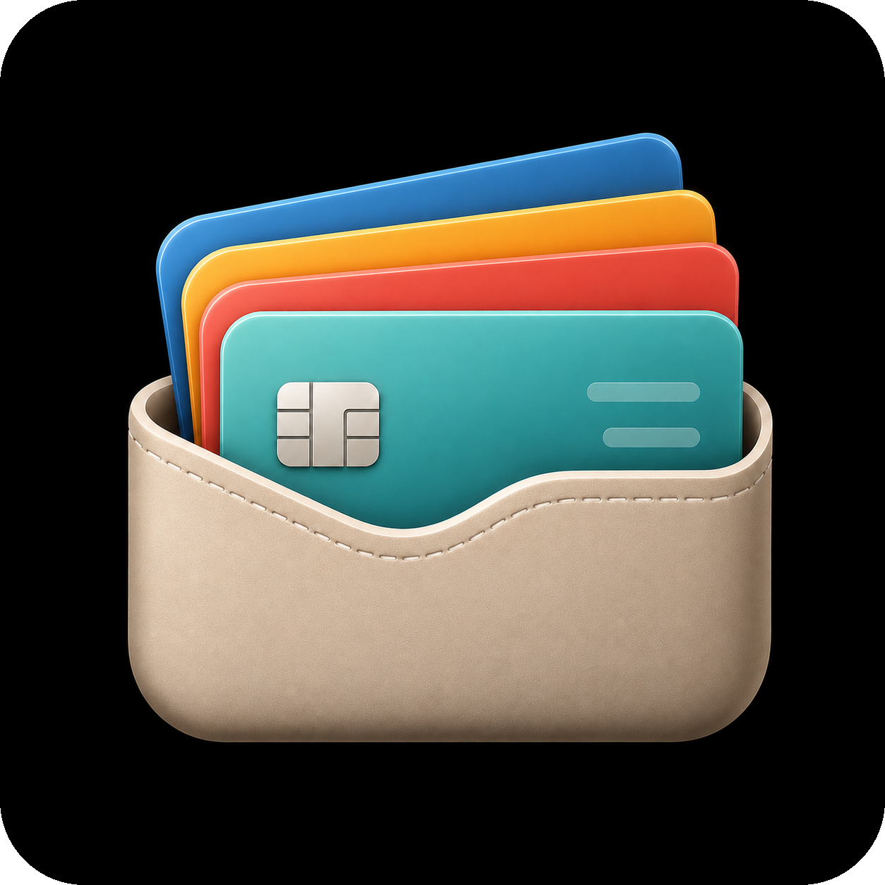
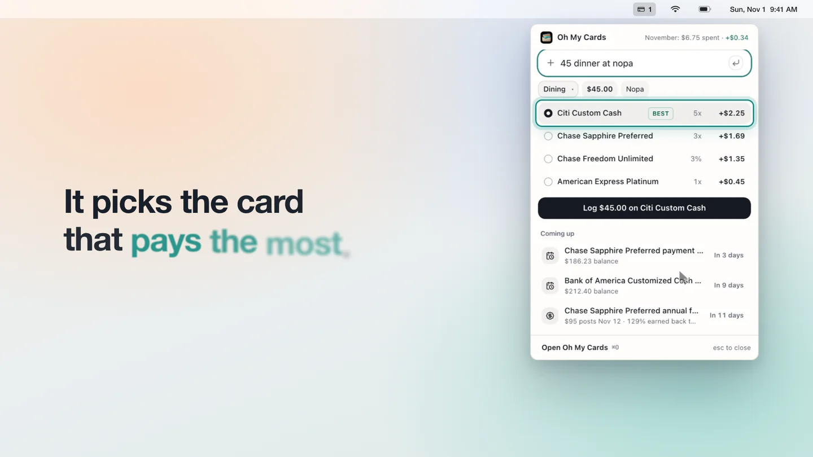
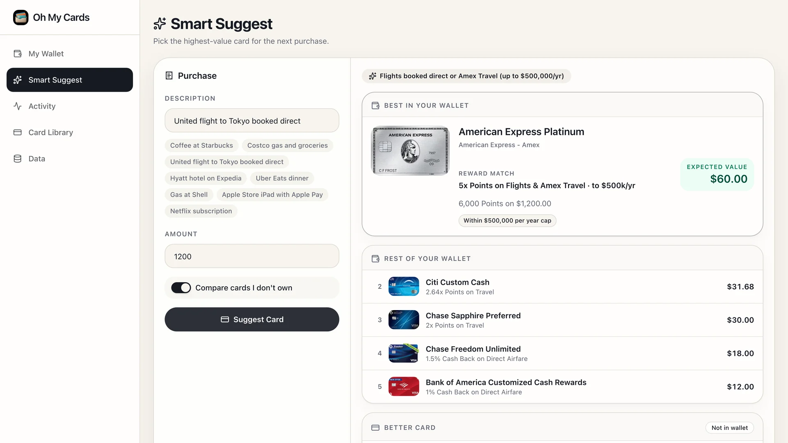
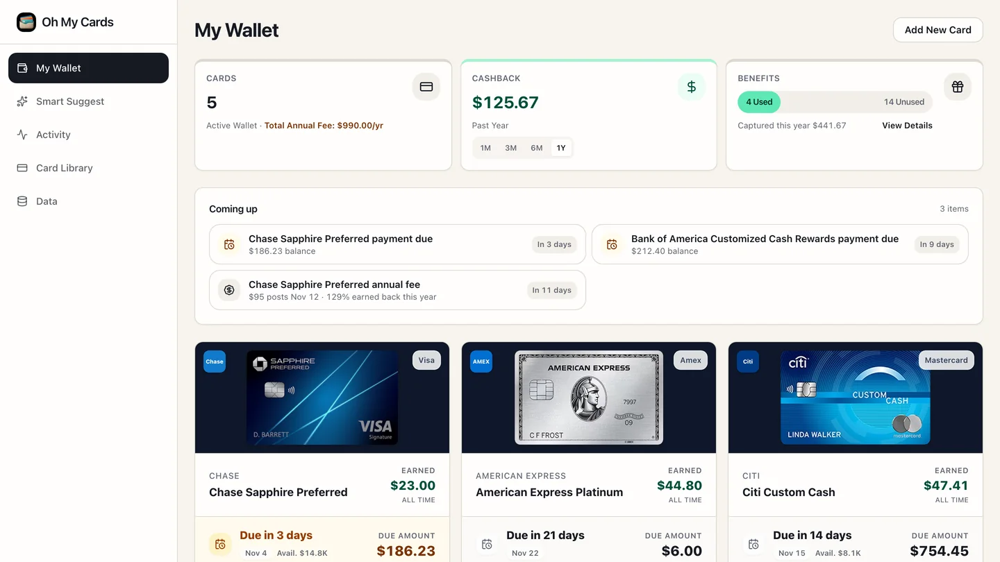
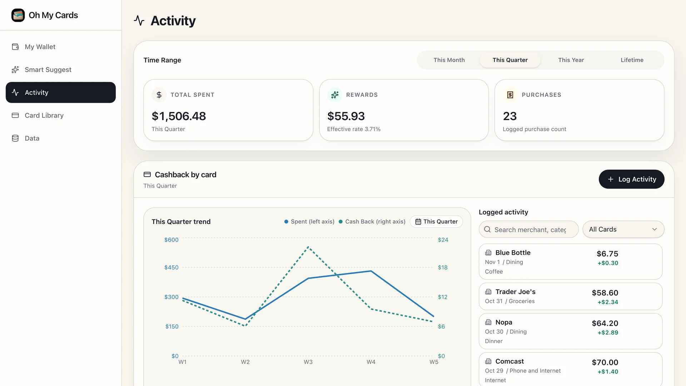

<div align="center">



# Oh My Cards

**Know which card to use. Never miss a due date or a credit.<br>Everything stays on your device.**

<a href="https://github.com/ChenFangfc/Oh_My_Cards/releases/latest/download/Oh-My-Cards.dmg"></a>
<a href="https://chenfangfc.github.io/Oh_My_Cards/"></a>
<a href="README.zh-CN.md"></a>

<br><br>

<a href="https://chenfangfc.github.io/Oh_My_Cards/video/oh-my-cards.en.mp4"><picture><source type="image/avif" srcset="docs/promo/preview.en.avif"></picture></a>

<sub><a href="https://chenfangfc.github.io/Oh_My_Cards/video/oh-my-cards.en.mp4"><b>▶ Watch with sound (0:32)</b></a> · <a href="https://github.com/ChenFangfc/Oh_My_Cards/releases/download/v1.2.0/Oh-My-Cards-film-4K.en.mp4"><b>4K</b></a> · <a href="https://chenfangfc.github.io/Oh_My_Cards/video/oh-my-cards.zh.mp4"><b>中文版</b></a></sub>

</div>

---

A free credit card organizer for anyone carrying more than one card. Type a purchase and it tells you which card earns the most. It keeps track of payment dates, annual fees and credits, and it works without an account or a bank login.

## Features

<table>
<tr>
<td width="50%"><br><b>Menu bar quick log</b> · type “45 dinner at nopa”, press Enter, done. <kbd>⌃⌥⌘Space</kbd> from any app.</td>
<td width="50%"><br><b>Smart Suggest</b> · ranks your wallet for any purchase, and shows the better cards you don't have.</td>
</tr>
<tr>
<td><br><b>Wallet</b> · due dates, balances, annual-fee progress and credits, card by card.</td>
<td><br><b>Activity</b> · spending and rewards by period, category and card. CSV export.</td>
</tr>
</table>

- **Priced the way issuers pay:** spend caps, rotating and chosen categories, merchant bonuses and point values.
- **180+ cards** from the US, Canada, Hong Kong and Singapore. Rules update on their own from a public feed.
- **English and 简体中文.** Purchases typed in Chinese work too.
- **Updates itself** on macOS. Each update is checked against a signing key built into the app.

## Download

- **macOS 11+** (Apple silicon & Intel): [**Oh-My-Cards.dmg**](https://github.com/ChenFangfc/Oh_My_Cards/releases/latest/download/Oh-My-Cards.dmg). Open it and drag the app into Applications. It isn't notarized yet, so the first time, open it from **System Settings → Privacy & Security → Open Anyway**.
- **Any browser:** [open the web app](https://chenfangfc.github.io/Oh_My_Cards/). It works offline and installs from the address bar.

## Privacy

Your wallet, purchases and settings live only in the app's storage on your device. On its own, the app fetches just two public things: card rules, and (on macOS) its own updates. It never sends anything about you. To move to another device, use **Data → Export / Import Backup**.

<details>
<summary><b>Development</b></summary>
<br>

```bash
corepack pnpm install
PORT=19957 BASE_PATH=/ corepack pnpm --dir artifacts/card-organizer dev   # web app on :19957
corepack pnpm --dir lib/api-client-react test                            # reward engine tests
corepack pnpm --dir artifacts/card-organizer desktop:build               # macOS app (needs Rust)
```

Pushing a `v*` tag builds the universal DMG, a signed update bundle and `latest.json`, and publishes them as a GitHub Release ([docs/local-app-release.md](docs/local-app-release.md)).

</details>

<details>
<summary><b>Keeping card data current</b></summary>
<br>

`scripts/src/card-data/` crawls every card's official page weekly and watches issuer news daily. It files what changed for review, and never edits the catalog on its own. Reviewed fixes go in as patches and are published as a rules feed that installed apps pick up within hours. See [scripts/src/card-data/README.md](scripts/src/card-data/README.md).

</details>

<details>
<summary><b>The film</b></summary>
<br>

Written as code in [`promo/`](promo/). Every frame is a function of time, the app's pages are real screenshots of a demo wallet, and the music is synthesised. `./promo/build.sh` renders both languages.

</details>

## Contributing

Card-rule corrections (with an official source), bug reports and ideas are welcome. Please [open an issue](https://github.com/ChenFangfc/Oh_My_Cards/issues).
