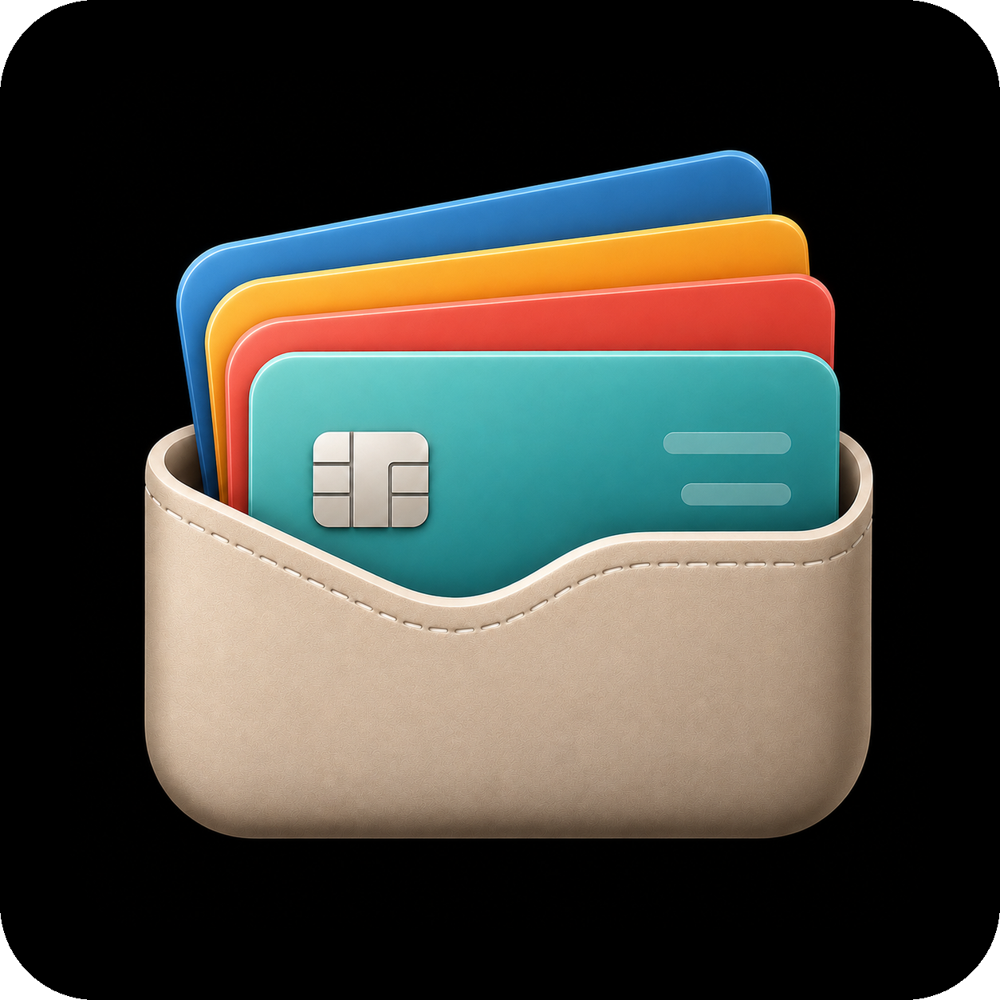
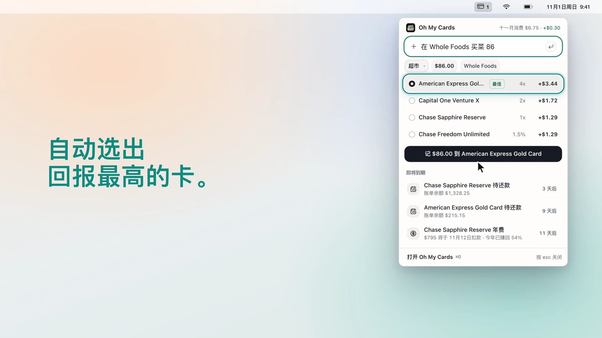
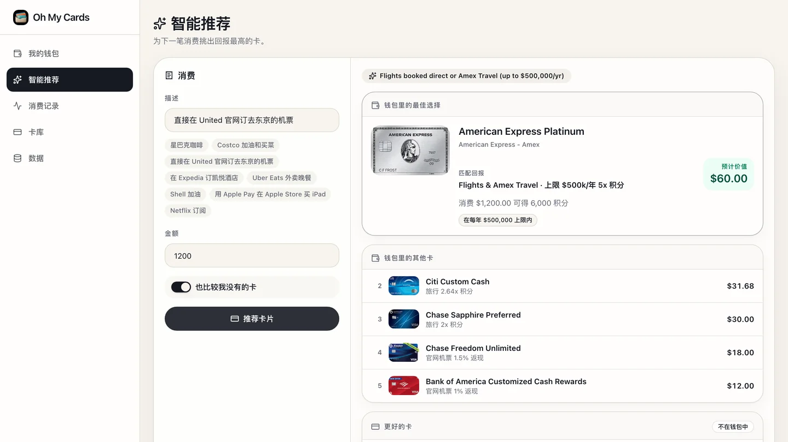
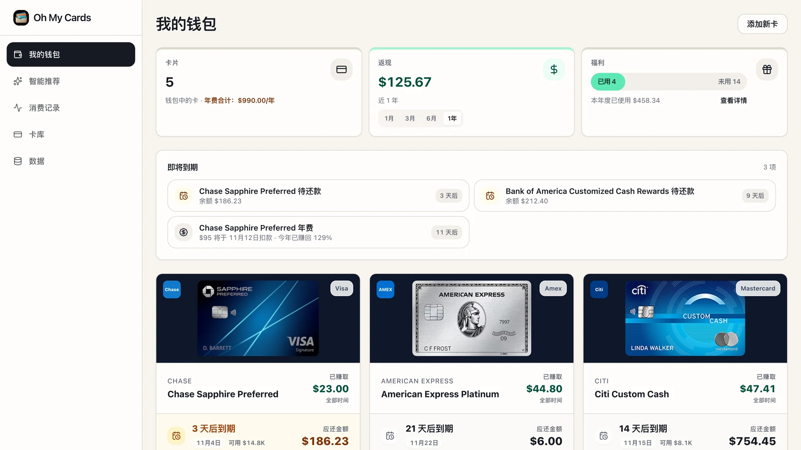
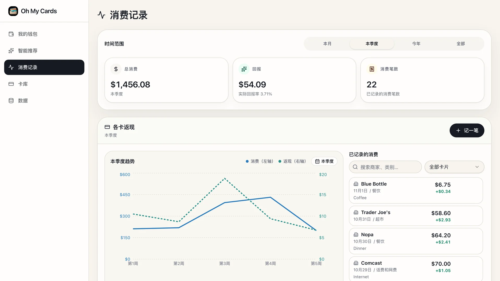

<div align="center">



# Oh My Cards

**每一笔都刷对卡，还款日和报销额度一个不漏。<br>所有数据只留在你自己的设备上。**

<a href="https://github.com/ChenFangfc/Oh_My_Cards/releases/latest/download/Oh-My-Cards.dmg"></a>
<a href="https://chenfangfc.github.io/Oh_My_Cards/"></a>
<a href="README.md"></a>

<br><br>

<a href="https://chenfangfc.github.io/Oh_My_Cards/video/oh-my-cards.zh.mp4"><picture><source type="image/avif" srcset="docs/promo/preview.zh.avif"></picture></a>

<sub><a href="https://chenfangfc.github.io/Oh_My_Cards/video/oh-my-cards.zh.mp4"><b>▶ 有声版 (0:32)</b></a> · <a href="https://github.com/ChenFangfc/Oh_My_Cards/releases/download/v1.2.0/Oh-My-Cards-film-4K.zh.mp4"><b>4K</b></a> · <a href="https://chenfangfc.github.io/Oh_My_Cards/video/oh-my-cards.en.mp4"><b>English</b></a></sub>

</div>

---

一个免费的信用卡管家，适合手里不止一张卡的人。写下买了什么，它告诉你刷哪张回报最高；还款日、年费和各种报销额度它帮你盯着；不用注册，也不连银行账户。

## 功能

<table>
<tr>
<td width="50%"><br><b>菜单栏快速记账</b> · 写一句“在 Whole Foods 买菜 86”，回车就记好。任何应用里按 <kbd>⌃⌥⌘Space</kbd> 呼出。</td>
<td width="50%"><br><b>智能推荐</b> · 任何消费都能给钱包里的卡排个序，还会列出你还没办、但更划算的卡。</td>
</tr>
<tr>
<td><br><b>钱包</b> · 每张卡的还款日、余额、年费回本进度和报销额度。</td>
<td><br><b>消费记录</b> · 按时间、类别、卡片看消费和回报，可导出 CSV。</td>
</tr>
</table>

- **按发卡行的真实规则计算**：消费上限、季度轮换和自选类别、商家加成、积分估值。
- **180+ 张卡**，覆盖美国、加拿大、香港和新加坡；规则通过公开数据源自动更新。
- **中文 / English 双语**，用中文写消费也能识别。
- **macOS 版自动更新**，每个更新包都会用应用内置的签名密钥校验。

## 下载

- **macOS 11+**（Apple 芯片和 Intel 通用）：[**Oh-My-Cards.dmg**](https://github.com/ChenFangfc/Oh_My_Cards/releases/latest/download/Oh-My-Cards.dmg)。打开后把应用拖进“应用程序”。还没做苹果公证，第一次需要到 **系统设置 → 隐私与安全性 → 仍要打开**。
- **任意浏览器**：[打开网页版](https://chenfangfc.github.io/Oh_My_Cards/)，离线可用，也能从地址栏安装成应用。

## 隐私

钱包、消费记录和设置都只存在你设备上的应用存储里。应用自己只会下载两样公开的东西：卡片规则，以及（macOS 版的）自身更新。不会发送任何关于你的信息。换设备时用 **数据 → 导出 / 导入备份**。

<details>
<summary><b>开发</b></summary>
<br>

```bash
corepack pnpm install
PORT=19957 BASE_PATH=/ corepack pnpm --dir artifacts/card-organizer dev   # 网页版，端口 19957
corepack pnpm --dir lib/api-client-react test                            # 回报引擎测试
corepack pnpm --dir artifacts/card-organizer desktop:build               # macOS 应用（需要 Rust）
```

推送 `v*` 标签会构建通用版 DMG、签名的更新包和 `latest.json`，并发布到 GitHub Release（见 [docs/local-app-release.md](docs/local-app-release.md)）。

</details>

<details>
<summary><b>卡片数据如何保持最新</b></summary>
<br>

`scripts/src/card-data/` 每周抓取每张卡的官方页面，每天关注发卡行新闻，把变化整理出来等待审核，从不自动修改卡库。审核过的修正以补丁形式合入，再发布成规则源，已安装的应用几小时内就会更新。详见 [scripts/src/card-data/README.md](scripts/src/card-data/README.md)。

</details>

<details>
<summary><b>宣传片</b></summary>
<br>

在 [`promo/`](promo/) 里用代码生成：每一帧都是时间的函数，应用画面是演示钱包的真实截图，配乐也是合成的。运行 `./promo/build.sh` 可生成中英文两版。

</details>

## 参与贡献

欢迎提交卡片规则更正（请附官方来源）、问题反馈和功能建议，直接[提交 issue](https://github.com/ChenFangfc/Oh_My_Cards/issues) 即可。
